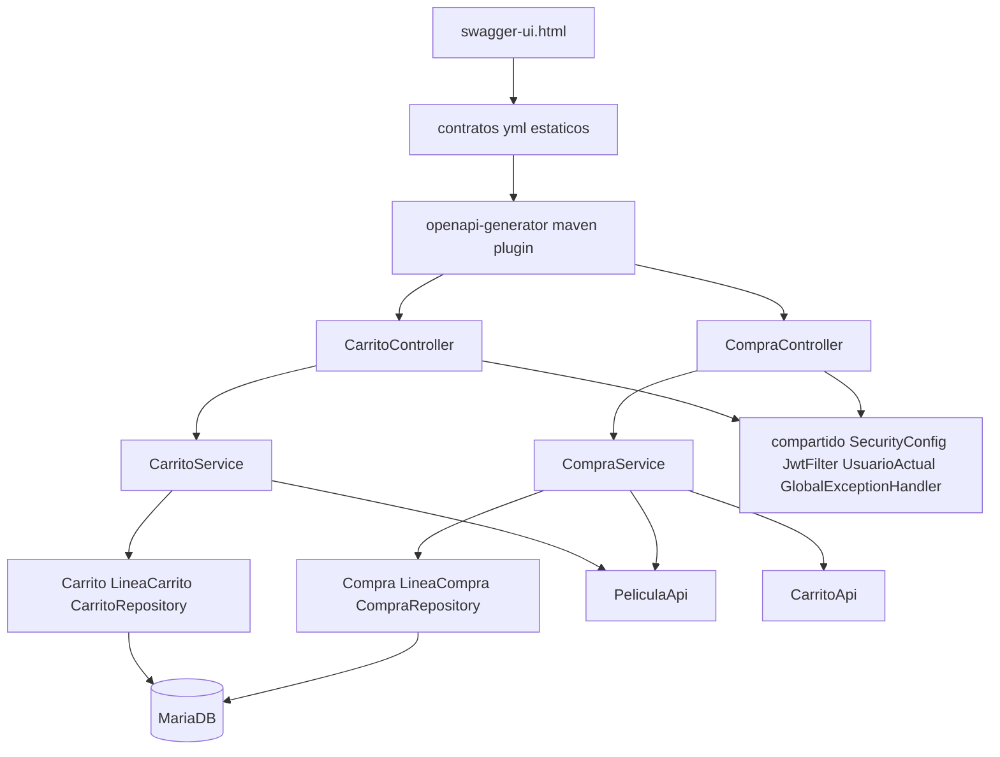
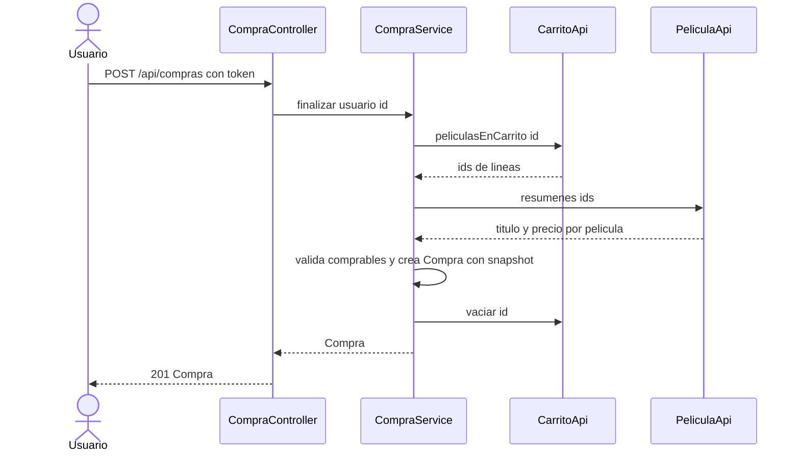

# Diseño

## Visión general
Dos módulos nuevos (`carrito`, `compra`) en el monolito modular existente, con endpoints definidos **API-first**: el contrato OpenAPI se escribe primero en YAML, se sirve estáticamente y genera las interfaces HTTP y los DTO con `openapi-generator-maven-plugin` (generador `spring`, modo `interfaceOnly`). Los controllers escritos a mano implementan la interfaz generada y delegan en los services, siguiendo el patrón actual. El precio vive en `pelicula` (`BigDecimal`); el carrito lo calcula al leer y la compra lo congela en el checkout. Todo exige token JWT (infraestructura existente); la página de Swagger UI estática permite ver y probar el contrato con el token.

**Usuarios**: usuario autenticado (carrito, checkout, historial); administrador (precio del catálogo); desarrollador que integra la API (contrato y página de prueba).

### Objetivos
- Contrato como fuente de verdad (Req 8): YAML servido en `/contratos/` y código generado del mismo fichero, sin copias.
- Comportamiento de precio requerido por construcción: precio vivo en carrito (Req 2.3) y snapshot inmutable en compra (Req 5.2, 5.3).
- Checkout atómico con una sola compra ante concurrencia (Req 5.6).

### No objetivos
- Pasarela de pago real, estados de pago, devoluciones, descuentos/impuestos/divisas, cantidades, carritos anónimos, notificaciones.
- Documentación interactiva para los endpoints ya existentes (`peliculas`, `valoracion`, `auth`): esta spec solo contrata carrito y compras.
- Refresh tokens, roles nuevos ni endpoints administrativos de carritos/compras.

## Compromisos de frontera

### Esta spec es dueña de
- Los contratos HTTP `/api/carrito/**` y `/api/compras/**` (dos YAML en `src/main/resources/static/contratos/`) y sus interfaces/DTO generados.
- El dominio y la lógica de carrito y compra (entidades, repositorios, services, limpieza por eliminación de película).
- La página estática de Swagger UI y las rutas públicas asociadas (`/swagger-ui.html`, `/contratos/**`, `/webjars/**`).
- La extensión del catálogo con `precio` (columna, validaciones y exposición en `PeliculaResumen`).
- Los datos: `carritos`, `lineas_carrito`, `compras`, `lineas_compra` (dueño exclusivo; nadie más lee ni escribe estas tablas).

### Fuera de frontera
- La autenticación (registro, login, emisión/validación de token) — ya existe en `autenticacion`/`compartido`; esta spec solo la consume.
- El catálogo en sí (alta/edición/búsqueda) — solo se añade el campo precio; el resto queda en la spec `peliculas`.
- El formato de error global y la traducción de excepciones — se reutiliza `GlobalExceptionHandler` (única adición: mapeo de bloqueo optimista a 409).
- El front estático de la aplicación (`index.html`/`app.js`): puede consumir los endpoints después; esta spec no lo cambia.

### Dependencias permitidas
- `carrito` → `pelicula` solo por `PeliculaApi` (y el evento `PeliculaEliminada`).
- `compra` → `carrito` solo por `CarritoApi`; `compra` → `pelicula` solo por `PeliculaApi`.
- Ambos módulos → `compartido` (`UsuarioActual`, excepciones de negocio). `compartido` no depende de módulos.
- Ambos módulos → clases generadas por el plugin dentro de su propio paquete `web.api`/`web.dto` (generadas, no commiteadas).
- Prohibido: dependencias inversas, acceso directo a `domain`/`application`/`web` de otro módulo, ciclos.

### Disparadores de revalidación
- Cambio en la forma de `PeliculaResumen` o `CarritoApi` (consumidores `compra`/`carrito` y el contrato YAML).
- Cambio de la versión de `openapi-generator` o de sus opciones (regeneración → revisar diff completo).
- Cambio de rutas públicas en `SecurityConfig` (afecta a la página de contrato).
- Cambio del formato de `ErrorRespuesta` (afecta al schema de error de los dos YAML).

## Arquitectura

Patrón seleccionado: **monolito modular** con las reglas de `.kiro/steering/structure.md` (capas `web → application → domain`, módulos comunicándose solo por su `Api` raíz y eventos, `compartido` independiente). Lo nuevo es la capa de contrato: cada módulo recibe su interfaz HTTP y DTOs generados desde su YAML.



- Generación en build: dos ejecuciones del plugin (`generate-sources`), una por módulo; el código generado va a `target/generated-sources/openapi` y no se commitea.
- El compilador impide la deriva contrato-código: `CarritoController implements CarritoRestApi` (generado). `skipDefaultInterface=true` hace abstractos los métodos: si un endpoint no se implementa, no compila.
- Patrones existentes preservados: entidades anémicas, DTOs record, `UsuarioActual`, excepciones de negocio + `GlobalExceptionHandler`, fakes a mano en pruebas.

### Stack tecnológico

| Capa | Elección / versión | Rol en la feature | Notas |
|---|---|---|---|
| Backend | Java 26, Spring Boot 4.1.1 (existente) | Módulos `carrito` y `compra` | Sin cambios de stack |
| Codegen | `openapi-generator-maven-plugin` **7.26.0**, generador `spring` | Interfaces + DTO desde los YAML | Opciones: `useSpringBoot4=true`, `useJackson3=true`, `useRecords=true`, `interfaceOnly=true`, `skipDefaultInterface=true`, `useTags=true`, `requestMappingMode=api_interface`, `useResponseEntity=false`, `useBeanValidation=true`, `openApiNullable=false`, `documentationProvider=none`, `annotationLibrary=none`, `useSwaggerUI=false`, `dateLibrary=java8`, `hideGenerationTimestamp=true` |
| Documentación | `org.webjars:swagger-ui` (última 5.x) + `swagger-ui.html` estático | Página interactiva del contrato (Req 8) | Si el alias sin versión del webjar no resuelve, ruta con versión concreta |
| Datos | MariaDB vía JPA (`ddl-auto=update` existente) | Tablas nuevas + columna `precio` | Sin migración manual |
| Pruebas | JUnit 5, fakes a mano, MockMvc, ArchUnit (existente) | Ver Req 1–8 | `MODULOS += carrito, compra` |

## Plan de estructura de ficheros

```
src/main/resources/static/
├── contratos/
│   ├── carrito-api.yml           # contrato /api/carrito/** (tag CarritoRest, schema ErrorRespuesta)
│   └── compras-api.yml           # contrato /api/compras/** (tag ComprasRest, schema ErrorRespuesta)
└── swagger-ui.html               # página que carga ambos contratos con SwaggerUIBundle urls

src/main/java/org/example/
├── carrito/                      # módulo nuevo
│   ├── CarritoApi.java           # API pública del módulo: peliculasEnCarrito(usuarioId), vaciar(usuarioId)
│   ├── domain/
│   │   ├── Carrito.java          # id, usuarioId (único), @Version
│   │   ├── LineaCarrito.java     # id, carritoId, peliculaId; única por (carritoId, peliculaId)
│   │   └── CarritoRepository.java
│   ├── application/
│   │   ├── CarritoService.java   # implementa CarritoApi; ver/anadir/quitar/vaciar
│   │   ├── LineaDeCarrito.java   # record (peliculaId, titulo, precio) para web
│   │   ├── CarritoVista.java     # record (lineas, total)
│   │   └── LimpiezaPorPeliculaEliminada.java  # oyente de PeliculaEliminada: borra líneas
│   └── web/
│       └── CarritoController.java  # implements CarritoRestApi (generado); mapea a DTOs generados
├── compra/                       # módulo nuevo
│   ├── domain/
│   │   ├── Compra.java           # id, usuarioId, fecha, total, estado (COMPRADA)
│   │   ├── LineaCompra.java      # id, compraId, peliculaId, titulo, precioUnitario
│   │   └── CompraRepository.java
│   ├── application/
│   │   └── CompraService.java    # finalizar (checkout transaccional), listar, detalle
│   └── web/
│       └── CompraController.java   # implements ComprasRestApi (generado)
├── pelicula/                     # módulo existente, cambios mínimos
│   ├── PeliculaResumen.java      # + precio (BigDecimal, null si sin precio)
│   ├── domain/Pelicula.java      # + precio
│   └── web/
│       ├── PeliculaRequest.java  # + precio con validaciones @Positive @Digits(2)
│       └── PeliculaResponse.java # + precio
└── compartido/
    ├── SecurityConfig.java       # + permitAll /swagger-ui.html /webjars/** /contratos/**
    └── GlobalExceptionHandler.java # + ObjectOptimisticLockingFailureException → 409

pom.xml                           # plugin codegen ×2 + webjar swagger-ui

src/test/java/org/example/        # espejo de main, más:
├── arquitectura/ArquitecturaTest.java      # MODULOS += carrito, compra
├── carrito/application/CarritoServiceTest.java (+ repositorio falso)
├── carrito/web/CarritoControllerIntegracionTest.java
├── compra/application/CompraServiceTest.java (+ fakes de CarritoApi y PeliculaApi)
├── compra/web/CompraControllerIntegracionTest.java
├── compartido/FrontEstaticoIntegracionTest.java  # + carga de swagger-ui.html y /contratos/**
├── compartido/SeguridadIntegracionTest.java      # + 401 en carrito y compras
├── pelicula/application/PeliculaServiceTest.java # + validación de precio
└── pelicula/web/PeliculaControllerIntegracionTest.java # + precio en crear/editar/detalle
```

Generados (no en git, `target/generated-sources/openapi/`):
- `org/example/carrito/web/api/CarritoRestApi.java` + `org/example/carrito/web/dto/{Carrito,LineaCarrito,AnadirLinea,ErrorRespuesta}.java`
- `org/example/compra/web/api/ComprasRestApi.java` + `org/example/compra/web/dto/{Compra,LineaCompra,ErrorRespuesta}.java`

Modificados: los listados arriba (`PeliculaResumen`, `Pelicula`, `PeliculaRequest/Response`, `SecurityConfig`, `GlobalExceptionHandler`, `pom.xml`, `ArquitecturaTest` y tests existentes citados).

## Flujos del sistema

### Checkout (Req 5)



- Todo el flujo corre en una `@Transactional` de `CompraService`: o se crea la compra y se vacía el carrito, o nada.
- Si el carrito está vacío, una película desapareció o no tiene precio → `ConflictoException` (409) con el carrito intacto.
- Dos checkouts simultáneos: ambos leen la misma `version` de `Carrito`; el segundo falla al hacer flush (`ObjectOptimisticLockingFailureException`) → handler → 409. Una sola compra.
- La creación concurrente del carrito al añadir la primera línea se resuelve con UNIQUE(`usuario_id`) + captura de `DataIntegrityViolationException` y re-lectura.

## Trazabilidad de requisitos

| Requisito | Resumen | Componentes | Interfaces | Flujos |
|---|---|---|---|---|
| 1.1, 1.2, 1.3 | Precio obligatorio y validado al crear/editar | `Pelicula`, `PeliculaRequest`, `PeliculaService` | `POST/PUT /api/peliculas` | — |
| 1.4 | Precio visible en catálogo y detalle | `PeliculaResponse` | `GET /api/peliculas[/{id}]` | — |
| 1.5, 3.5, 5.5 | Película sin precio = no comprable | `CarritoService`, `CompraService` | `PeliculaApi.resumenes` | Checkout |
| 2.1, 2.4 | Carrito propio, vacío si no existe | `CarritoService.ver`, `CarritoController` | `GET /api/carrito` | — |
| 2.2, 2.3 | Precio vivo en líneas y total | `CarritoService.ver`, `PeliculaApi` | `GET /api/carrito` | — |
| 3.1, 3.2, 3.6 | Añadir línea, carrito implícito, validación de cuerpo | `CarritoService.anadir`, `AnadirLinea` (generado) | `POST /api/carrito/lineas` | — |
| 3.3, 3.4 | Duplicada 409, inexistente 404 | `CarritoService.anadir` | `POST /api/carrito/lineas` | — |
| 4.1, 4.2 | Quitar línea | `CarritoService.quitar` | `DELETE /api/carrito/lineas/{peliculaId}` | — |
| 4.3 | Vaciar carrito idempotente | `CarritoService.vaciar` | `DELETE /api/carrito` | — |
| 4.4 | Limpieza al eliminar película | `LimpiezaPorPeliculaEliminada` (carrito) | evento `PeliculaEliminada` | — |
| 5.1, 5.2 | Checkout con snapshot y vaciado atómico | `CompraService.finalizar` | `POST /api/compras`, `CarritoApi` | Checkout |
| 5.3 | Precio congelado tras la compra | `Compra`, `LineaCompra` (snapshot) | `GET /api/compras[/{id}]` | — |
| 5.4 | Carrito vacío → 409 | `CompraService.finalizar` | `POST /api/compras` | Checkout |
| 5.6 | Una sola compra ante doble checkout | `Carrito` con `@Version`, handler 409 | `POST /api/compras` | Checkout |
| 6.1, 6.2 | Historial propio ordenado y detalle | `CompraService.listar/detalle` | `GET /api/compras[/{id}]` | — |
| 6.3 | Compra ajena o inexistente → 404 | `CompraService.detalle` | `GET /api/compras/{id}` | — |
| 7.1, 7.2, 7.3 | Token obligatorio, identidad desde token, sin acceso ajeno | `SecurityConfig`, `UsuarioActual` | todos | — |
| 8.1, 8.4 | Contrato publicado + error uniforme documentado | `carrito-api.yml`, `compras-api.yml`, `ErrorRespuesta` (schema) | `/contratos/*.yml` | — |
| 8.2, 8.3 | Página interactiva con token persistente | `swagger-ui.html`, webjar, `SecurityConfig` | `/swagger-ui.html` | — |
| 8.5 | El contrato manda | `CarritoController`, `CompraController` (implements generados) | interfaces generadas | — |

## Componentes e interfaces

| Componente | Dominio/capa | Intención | Requisitos | Dependencias clave | Contratos |
|---|---|---|---|---|---|
| `carrito-api.yml` / `compras-api.yml` | contratos | Fuente de verdad HTTP | 8.1, 8.4, 8.5 | plugin codegen | API |
| Código generado (`CarritoRestApi`, `ComprasRestApi`, DTOs) | web de cada módulo | Interfaces y DTO del contrato | 8.5 | Spring MVC, Bean Validation | API |
| `CarritoController` | carrito/web | Implementa la interfaz generada y mapea | 2.x, 3.x, 4.x | `CarritoService` | API |
| `CarritoService` | carrito/application | Lógica de carrito; implementa `CarritoApi` | 2.x, 3.x, 4.x, 5.5 | `CarritoRepository`, `PeliculaApi`, `UsuarioActual` | Service |
| `CarritoApi` | carrito/raíz | API pública del módulo | 5.1 | — | Service |
| `LimpiezaPorPeliculaEliminada` (carrito) | carrito/application | Limpieza por evento | 4.4 | repositorio | Event |
| `CompraController` | compra/web | Implementa la interfaz generada y mapea | 5.x, 6.x | `CompraService` | API |
| `CompraService` | compra/application | Checkout transaccional e historial | 5.x, 6.x | `CompraRepository`, `CarritoApi`, `PeliculaApi`, `UsuarioActual` | Service |
| Precio en `pelicula` | pelicula | Campo, validación y exposición | 1.x | — | Service |
| `swagger-ui.html` + `SecurityConfig` | estático/compartido | Página de contrato y rutas públicas | 8.2, 8.3, 7.1 | webjar | API |
| `GlobalExceptionHandler` (extensión) | compartido | Bloqueo optimista → 409 | 5.6 | — | — |

### carrito

#### `CarritoService` (implements `CarritoApi`)

| Campo | Detalle |
|---|---|
| Intención | Gestionar el carrito propio y exponer lectura/vaciado al módulo compra |
| Requisitos | 2.1–2.4, 3.1–3.6, 4.1–4.4, 5.5 |

**Responsabilidades y restricciones**
- Dueño exclusivo de `carritos` y `lineas_carrito`. Invariante: una línea por película y carrito; precio nunca persistido en la línea.
- `ver(usuarioId)`: devuelve `CarritoVista(lineas, total)`; sin carrito → vista vacía con total cero. Las líneas se enriquecen con `PeliculaApi.resumenes(ids)` (título, precio actual). Defensivo: una línea cuya película ya no exista se omite.
- `anadir(usuarioId, peliculaId)`: crea el carrito si no existe (UNIQUE + re-lectura ante carrera); película inexistente → `RecursoNoEncontradoException`; ya en carrito → `ConflictoException`; precio null → `ConflictoException`. Devuelve `LineaDeCarrito` con precio actual.
- `quitar(usuarioId, peliculaId)`: sin esa línea → `RecursoNoEncontradoException`.
- `vaciar(usuarioId)`: idempotente (204 siempre).
- `peliculasEnCarrito(usuarioId)`: ids de las líneas; `vaciar(usuarioId)`: borra todas (usado por `CompraService` dentro de su transacción).

**Contratos**: Service ☑ / Event ☑ (oyente)

```java
public interface CarritoApi {
    List<Long> peliculasEnCarrito(Long usuarioId);
    void vaciar(Long usuarioId);
}
```

Records de aplicación (`application`): `LineaDeCarrito(Long peliculaId, String titulo, BigDecimal precio)`, `CarritoVista(List<LineaDeCarrito> lineas, BigDecimal total)`.

#### `CarritoController` (implements `CarritoRestApi` generado)

| Método | Ruta | Petición | Respuesta | Errores |
|---|---|---|---|---|
| GET | `/api/carrito` | — | 200 `Carrito` | 401 |
| POST | `/api/carrito/lineas` | `AnadirLinea {peliculaId}` (`@Valid`) | 201 `LineaCarrito` | 400, 401, 404, 409 |
| DELETE | `/api/carrito/lineas/{peliculaId}` | — | 204 | 401, 404 |
| DELETE | `/api/carrito` | — | 204 | 401 |

`@Valid` del cuerpo lo aplica el código generado (`useBeanValidation`); `usuarioId` siempre de `UsuarioActual.id()`. Con `useResponseEntity=false`, 201/204 van por `@ResponseStatus` generado, al estilo de los controllers actuales.

#### `LimpiezaPorPeliculaEliminada` (carrito)

- `@EventListener @Transactional` sobre `PeliculaEliminada`: borra las líneas de la película en todos los carritos (patrón idéntico al de `valoracion`). Requisito 4.4.

### compra

#### `CompraService`

| Campo | Detalle |
|---|---|
| Intención | Checkout atómico con snapshot de precios e historial propio |
| Requisitos | 5.1–5.6, 6.1–6.3 |

**Responsabilidades y restricciones**
- `finalizar(usuarioId)` (`@Transactional`): secuencia del diagrama; lanza `ConflictoException` si el carrito está vacío, una película ya no existe o no tiene precio; captura `ObjectOptimisticLockingFailureException` → `ConflictoException` (409). Postcondición: compra creada con estado `COMPRADA`, `LineaCompra` con `titulo` y `precioUnitario` del momento, `total` = suma, carrito vacío.
- `listar(usuarioId)`: compras del usuario por fecha descendente.
- `detalle(usuarioId, compraId)`: la compra si es suya; ajena o inexistente → `RecursoNoEncontradoException` (404, nunca 403).
- Sin `CompraApi` ni eventos publicados: hoy no hay consumidor (simplificación registrada en `research.md`).

**Contratos**: Service ☑

#### `CompraController` (implements `ComprasRestApi` generado)

| Método | Ruta | Petición | Respuesta | Errores |
|---|---|---|---|---|
| POST | `/api/compras` | — | 201 `Compra` | 401, 409 |
| GET | `/api/compras` | — | 200 lista `Compra` | 401 |
| GET | `/api/compras/{compraId}` | — | 200 `Compra` | 401, 404 |

### pelicula (cambios)

- `Pelicula`: campo `precio` `BigDecimal`, columna `DECIMAL(10,2)` **nullable en BD** solo por los datos previos a esta feature; en la API es obligatorio.
- `PeliculaRequest`: `@NotNull @Positive @Digits(integer = 8, fraction = 2)`; sin precio válido la petición se rechaza (400) al crear o editar (1.1, 1.2).
- `PeliculaResponse` y `PeliculaResumen`: incluyen `precio` (null en películas preexistentes) (1.4, 1.5). `valoracion` ignora el campo nuevo; cambio compatible.
- `PeliculaService`: no cambia (persiste el campo; validación en el DTO). Las películas editadas a partir de ahora deben llevar precio.

### compartido (cambios)

- `SecurityConfig`: `permitAll` para `GET /swagger-ui.html`, `/webjars/**`, `/contratos/**`. El resto de las nuevas rutas queda cubierto por `anyRequest().authenticated()` (7.1). Sin cambios de filtro ni de sesión.
- `GlobalExceptionHandler`: `@ExceptionHandler(ObjectOptimisticLockingFailureException.class)` → 409 con el cuerpo `ErrorRespuesta` estándar (5.6). Solo aplica a entidades con `@Version` (hoy, `Carrito`).

### Contratos OpenAPI (schemas)

- `carrito-api.yml`: `Carrito {lineas: [LineaCarrito], total}`, `LineaCarrito {peliculaId, titulo, precio}`, `AnadirLinea {peliculaId}`, `ErrorRespuesta {estado, mensaje, errores}`; `securitySchemes.bearerAuth` (http, bearer, JWT) global; ejemplos por respuesta de error.
- `compras-api.yml`: `Compra {id, fecha (date-time), estado (enum COMPRADA), lineas: [LineaCompra], total}`, `LineaCompra {peliculaId, titulo, precioUnitario}`, `ErrorRespuesta` (idéntico).
- Naming español coherente con el código; `multipleOf: 0.01` en importes (documental; el tipo Java generado es `BigDecimal`).
- `ErrorRespuesta` solo aparece en `@ApiResponse` de la interfaz generada (documentación), no en firmas: los errores reales los produce `GlobalExceptionHandler`, y el schema existe para que contrato y respuesta nunca difieran (8.4).

## Modelo de datos

Entidades anémicas; relaciones entre módulos como ids, sin asociaciones JPA cruzadas (regla de `structure.md`).

| Tabla | Campos | Restricciones |
|---|---|---|
| `carritos` | id PK, usuario_id, version | usuario_id único y NOT NULL; version BIGINT NOT NULL (bloqueo optimista) |
| `lineas_carrito` | id PK, carrito_id FK, pelicula_id | (carrito_id, pelicula_id) único; FK a `carritos` |
| `compras` | id PK, usuario_id, fecha, total, estado | fecha y total NOT NULL; estado NOT NULL (`COMPRADA`); índice en (usuario_id, fecha) |
| `lineas_compra` | id PK, compra_id FK, pelicula_id, titulo, precio_unitario | precio_unitario DECIMAL(10,2) NOT NULL; FK a `compras` |
| `peliculas` (existente) | + precio DECIMAL(10,2) | nullable en BD por datos previos; obligatorio en la API |

- `Compra.total` se almacena (lectura frecuente sin recalcular) y coincide con la suma de `precio_unitario`.
- `titulo` y `precio_unitario` son snapshot: el historial no cambia si la película se edita o elimina.
- Coherencia: checkout en una transacción; creación del carrito protegida por UNIQUE; carrera de checkout por `@Version`.
- Fechas: entidad `LocalDateTime` (zona del servidor); el DTO usa `date-time` (OffsetDateTime generado) y la conversión vive en `web`.
- Migración: `ddl-auto=update` añade tablas y columna; sin pasos manuales. Películas previas quedan con `precio` null → no comprables (1.5) hasta que el admin las edite.

## Manejo de errores

Reutiliza `GlobalExceptionHandler` (formato `ErrorRespuesta {estado, mensaje, errores}`) y `SecurityConfig` (401/403 antes del controller). Catalogación por endpoint:

| Situación | Estado |
|---|---|
| Cuerpo inválido, película sin id válido (`@Valid`) | 400 |
| Sin token / token inválido o caducado | 401 |
| Película inexistente; línea o compra inexistente o ajena | 404 |
| Ya en carrito; sin precio; carrito vacío al checkout; película desaparecida al checkout; doble checkout (bloqueo optimista) | 409 |

Ningún error nuevo inventa formato: todo encaja en el cuerpo existente que el schema `ErrorRespuesta` replica.

## Estrategia de pruebas

**Unitarias de `application`** (dobles a mano, sin Spring):
- `CarritoServiceTest`: añadir primera línea crea carrito (3.2); duplicada → conflicto (3.3); película inexistente → 404 (3.4); sin precio → conflicto (3.5); `ver` calcula precios y total con `PeliculaApi` falso y precio vivo (2.2, 2.3); quitar inexistente → 404 (4.2); vaciar idempotente (4.3); solo líneas propias (2.4); películas no comprables detectadas (5.5, 1.5).
- `CompraServiceTest`: checkout feliz con snapshot de titulo/precio/total y vaciado (5.1, 5.2); precio tras la compra no cambia (5.3); carrito vacío → conflicto (5.4); película desaparecida/sin precio → conflicto y carrito intacto (5.5); bloqueo optimista → conflicto (5.6); historial propio ordenado (6.1) y detalle ajeno → 404 (6.3).

**Integración (MockMvc + seguridad real + BD de prueba)**:
- `CarritoControllerIntegracionTest` y `CompraControllerIntegracionTest`: tabla de códigos completa (200/201/204/400/401/404/409) contra los endpoints generados; cuerpo de error `ErrorRespuesta` (8.4); compra ajena → 404 (6.3).
- `PeliculaControllerIntegracionTest` (+precio): crear/editar con precio válido e inválido (1.1, 1.2) y detalle con precio (1.4).
- `SeguridadIntegracionTest`: 401 sin token en todas las rutas nuevas (7.1); sin 403 esperado (no hay endpoints de admin en carrito/compras).
- `FrontEstaticoIntegracionTest`: `/swagger-ui.html`, `/contratos/*.yml` y webjar accesibles sin token (8.2, 8.3).

**Arquitectura (ArchUnit)**: `MODULOS += carrito, compra` — módulos solo por su `Api`, sin ciclos, `compartido` independiente; verificación de que la dirección `compra → carrito → pelicula` se mantiene.

**Contrato (API-first)**:
- Tarea-spike primero: generar con las opciones del stack y compilar con Boot 4.1/Java 26 (riesgo principal, `research.md`).
- `openapi-generator:validate` en el build para validar los YAML.
- Verificación de contrato extremo a extremo (manual/opcional): schemathesis contra `/contratos/*.yml` con la API levantada; E2E del flujo crítico carrito → checkout → historial ya cubierto por las pruebas de integración.

## Seguridad
- Autorización: identidad solo desde el token (`UsuarioActual.id()`); ningún endpoint acepta usuario en el cuerpo o la ruta (7.2). Sin operaciones sobre recursos ajenos, tampoco para ADMIN (7.3): 404 en vez de 403 para no revelar existencia (6.3).
- Contrato y UI públicos sin token (`/contratos/**`, `/swagger-ui.html`, `/webjars/**`): no exponen datos, solo formas de la API; las peticiones de prueba exigen el token igualmente (8.3).
- Sin cambios en JWT, BCrypt ni gestión de secretos (steering).
